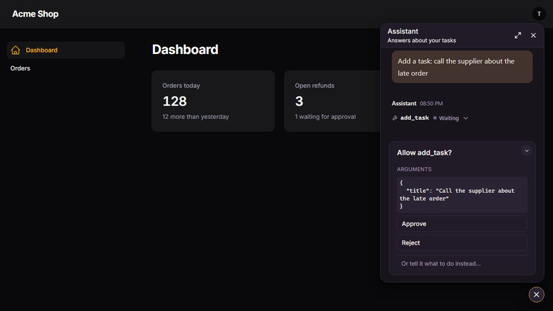

# aparté for Laravel

An AI chat for Blade, Livewire and Filament pages, wired to the [Laravel AI SDK](https://laravel.com/docs/ai-sdk).
No React and no build step: replies stream with Markdown, tool calls show as they run, and a person can
approve or refuse them.



It is built on [aparté](https://apartejs.dev), a chat UI made of web components, and needs PHP 8.3+, Laravel 12 or 13
and `laravel/ai` 1.3+.

## Install

```bash
composer require apartejs/laravel
php artisan vendor:publish --provider="Laravel\Ai\AiServiceProvider"
php artisan migrate
```

The last two are the SDK's own setup: its configuration and the tables that keep conversations.

## Use it

An agent that keeps its conversations:

```php
namespace App\Ai\Agents;

use Laravel\Ai\Concerns\RemembersConversations;
use Laravel\Ai\Contracts\Agent;
use Laravel\Ai\Contracts\Conversational;
use Laravel\Ai\Promptable;

class Assistant implements Agent, Conversational
{
    use Promptable, RemembersConversations;

    public function instructions(): string
    {
        return 'You are a helpful assistant.';
    }
}
```

A route, and the chat in a view. Give it a height:

```php
// routes/web.php
Route::aparte('/chat', App\Ai\Agents\Assistant::class);
```

```blade
<x-aparte::chat endpoint="/chat" style="height: 32rem" />
```

Inside a Livewire component it works as is: it is excluded from Livewire's re-renders.

**Protect the route.** It spends your model budget and runs your tools, so give it the middleware your app needs:

```php
Route::aparte('/chat', App\Ai\Agents\Assistant::class)->middleware(['auth', 'throttle:20,1']);
```

## A button in the corner of the page

```blade
<x-aparte::launcher endpoint="/chat" label="Help" />
```

The chat opens above the button under a header: a title (the button's `label` unless you set `heading`), a line
under it, and a ✕. Add `maximizable` for a button in the header that maximizes the chat to the whole window, or
`maximizable="panel"` for a full-height panel along the edge that keeps the page in view:

```blade
<x-aparte::launcher
    endpoint="/chat"
    label="Help"
    heading="Support"
    subheading="Usually answers in a minute"
    maximizable
/>
```

Escape brings a maximized chat back to its card. The [launcher's page](https://apartejs.dev/components/launcher/)
lists everything it takes, and the header's colours are yours to set in CSS.

## Filament

```php
use Aparte\Laravel\Filament\ApartePlugin;

$panel->plugin(ApartePlugin::make()->agent(App\Ai\Agents\Assistant::class)->label('Assistant'));
```

Works with Filament 4 and 5. Every page of the panel gets the button, for whoever is signed in to it. The route is
added for you, behind the
panel's authentication, and the chat follows the panel's light or dark mode.

The header and the maximize button are options of the plugin, off unless you call them:

```php
$panel->plugin(
    ApartePlugin::make()
        ->agent(App\Ai\Agents\Assistant::class)
        ->label('Assistant')
        ->heading('Assistant')
        ->subheading('Answers about your data')
        ->maximizable(), // or ->maximizable('panel') to keep the page in view
);
```

## Approving tool calls

A tool that needs a person uses the SDK's approvals:

```php
public function tools(): iterable
{
    return [(new SendInvoice)->requireApproval('Sending an invoice.')];
}
```

The chat asks before the tool runs. The model answers a refusal, and reads what the person typed in its place. A pending
question comes back after a reload.

## Slots

```blade
<x-aparte::chat endpoint="/chat" style="height: 32rem">
    <x-slot:empty-state><p>How can I help?</p></x-slot:empty-state>
    <x-slot:above-composer><p>Answers may be wrong.</p></x-slot:above-composer>
    <x-slot:toolbar><button type="button" style="margin-inline-start: auto">Help</button></x-slot:toolbar>
</x-aparte::chat>
```

## Plugins

The package serves a built chat: Markdown, tool calls and approvals. To add aparté's
[plugins](https://apartejs.dev/plugins/) (cards, maths, diagrams, charts, code highlighting) or cards of your own, build
the chat with your app's Vite instead, so that the plugins and the chat share one copy of aparté.

Tell the package to stop serving its own copy, in `.env`:

```env
APARTE_ASSETS=vite
```

Install the chat and the plugins you want:

```bash
npm install @aparte/core@^1 @aparte/runner-ag-ui@^1 @aparte/plugin-marked@^1 marked
npm install @aparte/plugin-katex@^1 katex
```

Give the chat an entry of its own, which imports the package's script and adds each plugin to every chat with
`onAparteSetup`:

```js
// resources/js/chat.js
import { onAparteSetup } from '../../vendor/apartejs/laravel/resources/js/aparte.js';
import 'katex/dist/katex.min.css';
import { setupKatex } from '@aparte/plugin-katex';

onAparteSetup((config) => setupKatex({}, config));
```

Add it to the inputs in `vite.config.js`, so that the production build has it:

```js
laravel({ input: ['resources/css/app.css', 'resources/js/app.js', 'resources/js/chat.js'] }),
```

Load it on the pages that show a chat, with `@vite('resources/js/chat.js')`. In a Filament panel:

```php
use Filament\View\PanelsRenderHook;
use Illuminate\Support\Facades\Blade;

$panel->renderHook(PanelsRenderHook::HEAD_END, fn (): string => Blade::render("@vite('resources/js/chat.js')"));
```

A separate entry keeps your `app.js` out of the panel: a second Alpine, or your app's styles, would break Filament's.

- `onAparteSetup` receives each chat's config, and the chat element as its second argument. What it returns, if a
  function, runs when the chat stops. Call it at the top level of that entry and keep it synchronous: a chat starts
  once the entry has run.
- The import reads from `vendor/`, so run `composer install` before `npm run build`, in CI and Docker builds too.
- If you install the package from a local path (a Composer path repository), Vite follows the link to the package's
  own folder: add `resolve: { dedupe: ['@aparte/core', '@aparte/runner-ag-ui', '@aparte/plugin-marked', 'marked'] }`
  to `vite.config.js` so that every import resolves from your app.
- After changing `APARTE_ASSETS` in production, run `php artisan config:cache` again.

## Good to know

- **The look** is set with aparté's [CSS variables](https://apartejs.dev/guides/theming/). It follows the system's light or dark
  mode; `follow-dark-class` makes it follow Tailwind's `dark` class instead.
- **What is kept:** the SDK keeps the conversation in your database, tied to the signed-in user, and the model's memory comes
  from there. What is on screen is kept for the tab: closing it starts a new conversation.
- **A conversation** is identified by an id the browser creates, or by `thread="..."` on the component.
- **Guests** can chat if your route allows them. Their conversations belong to nobody, so the id is all that protects one.
- **In production,** replies stream through nginx and PHP-FPM with no configuration: the SDK tells nginx not to buffer them.
  Each reply in progress holds a PHP worker until it ends, so count them in `pm.max_children`.
- **The SDK's AG-UI stream,** which this package reads, is not in its documentation yet, so a new `laravel/ai` version could
  change it.
- **The built chat follows aparté:** within a day of a new aparté 1.x, a patch release of this package carries it, once the
  rebuilt chat has passed its browser test. `composer update apartejs/laravel` brings it. In Vite mode, your own
  `npm update` does.

## Develop

```bash
composer install
vendor/bin/pest
npm install && npm run build   # rebuilds dist/, which is committed
cd tests/browser && npm install && node smoke.mjs   # the built chat in Chromium
```

MIT license.
