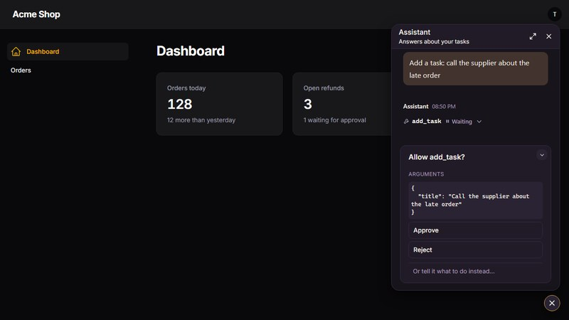

# aparté for Laravel

An AI chat for Blade, Livewire and Filament pages, wired to the [Laravel AI SDK](https://laravel.com/docs/ai-sdk).
No React and no build step: replies stream with Markdown, tool calls show as they run, and a person can
approve or refuse them.



It is built on [aparté](https://apartejs.dev), a chat UI made of web components, and needs PHP 8.3+, Laravel 12 or 13
and `laravel/ai` 1.3+.

## Install

```bash
composer require apartejs/laravel
php artisan vendor:publish --provider="Laravel\Ai\AiServiceProvider"
php artisan migrate
```

The last two are the SDK's own setup: its configuration and the tables that keep conversations.

## Use it

An agent that keeps its conversations:

```php
namespace App\Ai\Agents;

use Laravel\Ai\Concerns\RemembersConversations;
use Laravel\Ai\Contracts\Agent;
use Laravel\Ai\Contracts\Conversational;
use Laravel\Ai\Promptable;

class Assistant implements Agent, Conversational
{
    use Promptable, RemembersConversations;

    public function instructions(): string
    {
        return 'You are a helpful assistant.';
    }
}
```

A route, and the chat in a view. Give it a height:

```php
// routes/web.php
Route::aparte('/chat', App\Ai\Agents\Assistant::class);
```

```blade
<x-aparte::chat endpoint="/chat" style="height: 32rem" />
```

Inside a Livewire component it works as is: it is excluded from Livewire's re-renders.

**Protect the route.** It spends your model budget and runs your tools, so give it the middleware your app needs:

```php
Route::aparte('/chat', App\Ai\Agents\Assistant::class)->middleware(['auth', 'throttle:20,1']);
```

## A button in the corner of the page

```blade
<x-aparte::launcher endpoint="/chat" label="Help" />
```

The chat opens above the button under a header: a title (the button's `label` unless you set `heading`), a line
under it, and a ✕. Add `maximizable` for a button in the header that maximizes the chat to the whole window, or
`maximizable="panel"` for a full-height panel along the edge that keeps the page in view:

```blade
<x-aparte::launcher
    endpoint="/chat"
    label="Help"
    heading="Support"
    subheading="Usually answers in a minute"
    maximizable
/>
```

Escape brings a maximized chat back to its card. The [launcher's page](https://apartejs.dev/components/launcher/)
lists everything it takes, and the header's colours are yours to set in CSS.

## Filament

```php
use Aparte\Laravel\Filament\ApartePlugin;

$panel->plugin(ApartePlugin::make()->agent(App\Ai\Agents\Assistant::class)->label('Assistant'));
```

Works with Filament 4 and 5. Every page of the panel gets the button, for whoever is signed in to it. The route is
added for you, behind the
panel's authentication, and the chat follows the panel's light or dark mode.

The chat opens under a header titled with the `label`. A different title, a line under it and a maximize button are
options of the plugin; there is no maximize button unless you call `maximizable()`:

```php
$panel->plugin(
    ApartePlugin::make()
        ->agent(App\Ai\Agents\Assistant::class)
        ->label('Assistant')
        ->heading('Assistant')
        ->subheading('Answers about your data')
        ->maximizable(), // or ->maximizable('panel') to keep the page in view
);
```

To keep each person's conversations and give the chat its list, publish the table once and call `conversations()`:

```bash
php artisan vendor:publish --tag=aparte-migrations
php artisan migrate
```

```php
$panel->plugin(
    ApartePlugin::make()
        ->agent(App\Ai\Agents\Assistant::class)
        ->maximizable()
        ->conversations(),
);
```

The chat's header then names the open conversation and starts a new one, and a menu button opens the list: a drawer
inside the chat's card, and a column beside the chat once it is maximized. The routes are added for you, behind the
panel's authentication, and each panel keeps a list of its own: its conversations are not those of another panel, or
of a chat on a page of your app. [Conversations in your database](#conversations-in-your-database) says what is kept,
and how to change it.

## Approving tool calls

A tool that needs a person uses the SDK's approvals:

```php
public function tools(): iterable
{
    return [(new SendInvoice)->requireApproval('Sending an invoice.')];
}
```

The chat asks before the tool runs. The model answers a refusal, and reads what the person typed in its place. A pending
question comes back after a reload.

## Slots

```blade
<x-aparte::chat endpoint="/chat" style="height: 32rem">
    <x-slot:empty-state><p>How can I help?</p></x-slot:empty-state>
    <x-slot:above-composer><p>Answers may be wrong.</p></x-slot:above-composer>
    <x-slot:toolbar><button type="button" style="margin-inline-start: auto">Help</button></x-slot:toolbar>
</x-aparte::chat>
```

## A list of conversations

aparté's own elements go in the view around the chat, and follow it with no script of yours:

```blade
<div class="aparte-app-shell" style="height: 40rem" wire:ignore>
    <aparte-sidebar>
        <div class="aparte-sidebar__header">
            <button type="button" class="aparte-btn aparte-btn--surface" data-aparte-new-chat>New chat</button>
        </div>
        <div class="aparte-sidebar__search">
            <input type="search" class="aparte-field" placeholder="Search chats" aria-label="Search chats" data-aparte-sidebar-search>
        </div>
        <div class="aparte-sidebar__body">
            <aparte-conversation-list manage></aparte-conversation-list>
        </div>
    </aparte-sidebar>
    <header class="aparte-app-header">
        <button type="button" class="aparte-btn aparte-app-header__toggle" data-aparte-sidebar-toggle>Chats</button>
        <span class="aparte-app-header__title" data-aparte-title>New chat</span>
    </header>
    <div class="aparte-app-shell__main">
        <x-aparte::chat endpoint="/chat" style="height: 100%" />
    </div>
</div>
```

- `<aparte-conversation-list>` shows the chat's conversations, grouped by date. A click opens one, and with `manage` a
  row's menu renames or deletes it ([its page](https://apartejs.dev/components/conversation-list/)).
- `data-aparte-new-chat` on a button opens an empty conversation.
- `data-aparte-title` on an element names the open conversation; its own words stand while there is no name.
- `<aparte-sidebar>`, its search field and its toggle are aparté's ([its page](https://apartejs.dev/components/sidebar/)):
  on a narrow screen the sidebar becomes a drawer.

An element belongs to the chat in the same block as it. On a page with several chats, give each its own block, or name
the chat: give it an id, `<x-aparte::chat id="support" endpoint="/chat" />`, and write `for="support"` on the element.
`wire:ignore` keeps Livewire from redrawing what the elements draw.

The floating chat draws all of this itself when asked, in its card: a menu button in its header opens the list as a
drawer, and it is a column beside the chat once the chat is maximized.

```blade
<x-aparte::launcher endpoint="/chat" label="Help" maximizable list />
```

The list shows what the chat keeps: by default, the conversations of this tab. Keep them
[in your database](#conversations-in-your-database), or in [a storage of your own](#your-own-storage-your-own-runner).

## Conversations in your database

A chat keeps its conversations for the tab. To keep them for the person signed in, on every device, publish the
table:

```bash
php artisan vendor:publish --tag=aparte-migrations
php artisan migrate
```

Add the routes beside the chat's, behind the middleware that signs people in:

```php
// routes/web.php
Route::middleware(['auth'])->group(function () {
    Route::aparte('/chat', App\Ai\Agents\Assistant::class);
    Route::aparteConversations('/chat/conversations');
});
```

And name them on the chat, on a page behind the same sign-in as the routes:

```blade
<x-aparte::chat endpoint="/chat" conversations="/chat/conversations" style="height: 32rem" />
```

[The list](#a-list-of-conversations) then shows them, and a conversation opens as it was left, tool calls included.

The floating chat takes the same option, and then draws its list for whoever is signed in:

```blade
<x-aparte::launcher endpoint="/chat" conversations="/chat/conversations" label="Help" maximizable />
```

Two chats that answer with two agents keep two lists. The routes of the second one name its own, and chats whose
routes share a name share their conversations:

```php
Route::aparteConversations('/help/conversations', 'help');
```

Its words (`Conversations`, `New chat`, `Search chats`, `Maximize`, `Close`) go through Laravel's translator, in
[ten languages](#good-to-know) already; your `lang/*.json` files win. In a Filament panel, [`->conversations()`](#filament) does all of this.

- **What is kept** is what the chat shows, as the browser sends it after each reply, in the `aparte_conversations`
  table. Each person reads and writes their own only; a guest's conversations stay in the tab.
- **The model's memory** stays with the Laravel AI SDK, under the same id. Deleting a conversation from the list
  deletes both. Each conversation of a list is its own thread: `thread="..."` is for a chat that has one conversation
  and no list, and is not used on a chat that has one.
- **Whatever answers the chat:** with [a runner of your own](#your-own-storage-your-own-runner), the conversations
  are kept the same way.
- **Limits** are in `config/aparte.php` (`php artisan vendor:publish --tag=aparte-config`): `conversations.max_bytes`,
  what one conversation may weigh (2 MB); `conversations.list`, how many the list gives (200); `conversations.table`.
  Your web server must let a request of that weight through: nginx stops at 1 MB unless `client_max_body_size` says
  otherwise. The routes take your own middleware, a rate limit among them:
  `Route::aparteConversations('/chat/conversations')->middleware('throttle:120,1')`.
- **Somewhere else than that table:** bind your own `Aparte\Laravel\Conversations\ConversationRepository` in a service
  provider. It has five methods: list, find, save, change, delete.
- A reply still being written when its tab was closed is not in what is kept; the model remembers it.
- The same conversation open in two tabs is kept as the last of the two to save left it.
- **If the server does not answer,** the chat goes on. What is said is sent once it answers again: at the next
  message, when the network or the page comes back, and at longer and longer intervals in between.
- **A conversation the server refuses** is not kept: one heavier than `max_bytes`, or anything once nobody is signed
  in any more. The chat says so with an event, on the page, for you to tell the person:

```js
document.addEventListener('aparte-conversations-problem', (event) => {
    // event.detail.reason: 'too-large', 'signed-out', 'unreachable', 'refused' or 'gone' (deleted somewhere else).
    if (event.detail.reason === 'too-large') {
        alert('This conversation is too long to be kept. A new chat starts a fresh one.');
    }
});
```

## A person takes over

Someone of your team can answer in the chat instead of the assistant: they take the conversation over, write under their
own name, mark what they read, and hand it back. The visitor sees a line, "Marie joined the conversation", Marie's
messages under her name and picture, "Read by Marie" under their own, and the assistant answering again once she hands
it back, having read what she wrote. The package carries all of it between your server and the page. The desk, where
your team sees and answers conversations, is yours: a Filament page, for one.

**1. Who holds a conversation.** Yours to keep, a ticket or a column; the package asks:

```php
// app/Providers/AppServiceProvider.php, in boot()
use Aparte\Laravel\People;

People::heldBy(fn (string $conversationId) => Ticket::openFor($conversationId)?->agent?->only(['name', 'avatar']));
```

**2. The routes, and the chat.** Register the people routes beside the chat route, in `routes/web.php`, so the session
recognises the same person on both:

```php
// routes/web.php
Route::aparte('/chat', App\Ai\Agents\Support::class)->middleware('throttle:20,1');
Route::apartePeople('/chat/people');
```

```blade
<x-aparte::chat endpoint="/chat" people="/chat/people" style="height: 32rem" />
```

**3. Broadcasting.** What your team does reaches the page through Laravel's broadcasting (Reverb, Pusher…) and
Laravel Echo on the page (`php artisan install:broadcasting`); the chat uses `window.Echo` when it is there. A signed-in
person's conversation is sent on a private channel. Authorize it:

```php
// routes/channels.php
use Aparte\Laravel\People;
use Illuminate\Support\Facades\Broadcast;

Broadcast::channel('aparte.conversations.{id}', fn ($user, string $id) => People::owns($user, $id));
```

A guest has no one to authorize: their conversation is sent on a public channel under a name made from its id and your
app key, which only their browser is given.

**4. Your desk.**

```php
use Aparte\Laravel\People;

$marie = ['name' => 'Marie', 'avatar' => 'https://example.com/marie.png'];

// Marie accepts the conversation: update what heldBy reads, then
People::takeOver($conversationId, $marie);  // "Marie joined the conversation"; the assistant stops answering
People::post($conversationId, $marie, 'I have checked: your order ships today.');
People::read($conversationId, $messageId, 'Read by Marie');
People::handBack($conversationId);          // "The assistant is back"; it answers the next message
```

What the visitor writes meanwhile comes to your desk as an event:

```php
use Aparte\Laravel\Events\PersonWrote;
use Illuminate\Support\Facades\Event;

Event::listen(function (PersonWrote $event) {
    // $event->conversationId, $event->messageId (for People::read), $event->text
});
```

What the assistant reads: everything written during the takeover goes into its memory, Marie's messages as
`Marie: …`, so it answers knowing what she said. A message that reaches the chat route while someone holds the
conversation, sent a moment before the page heard of the takeover, is kept for your desk and not answered.

- **Your own words.** `takeOver` and `handBack` take the notice as their last argument:
  `People::takeOver($id, $marie, 'Marie a rejoint la conversation')`.
- **The conversation the visitor reopens.** When its conversations are kept by the package (`conversations="…"`), what
  your team does is written there too, and is still there when the visitor comes back. With a repository of your own,
  keep it from `PersonWrote` and `ConversationChanged`.
- **Not Echo.** Give the chat your own way to listen:
  `onAparteSetup((config, chat, options) => { options.people.subscribe = (id, onChange, channel) => { /* … */ return stop; }; })`,
  where `channel` is `{ name, private }` and `onChange` takes what `ConversationChanged` broadcasts.

### Typing and seen

While someone of your team is in the conversation, the chat tells your desk two things: that the person is typing
(`People::visitorTyping($id)` is true for a few seconds) and that they have seen your team's messages, the tab in
front of them (`PersonSaw`). Your desk tells the chat that someone of the team is typing, and the person reads
"Marie is typing…" above the composer:

```php
People::typing($conversationId, ['name' => 'Marie']);
```

### When the assistant hands over

Give your agent the `AskForSomeone` tool and the assistant can call your team itself: when the visitor asks for a
person, or when it cannot help. The chat says someone will answer, the assistant goes quiet, and your desk hears why:

```php
use Aparte\Laravel\Tools\AskForSomeone;

public function tools(): iterable
{
    return [new AskForSomeone(when: 'Use it for refunds, or when the user asks for a person.')];
}

// AppServiceProvider::boot()
Event::listen(SomeoneWanted::class, fn (SomeoneWanted $e) => /* notify your team: $e->conversationId, $e->reason */);
```

`People::wanted($id)` gives the reason while the conversation waits (your desk's "to take" list). It stops waiting
when someone takes it over or hands it back. `People::want($id, $reason)` does the same from your own code. The
visitor never sees the tool's call itself, only what the assistant and your team say.

### When the visitor asks

The visitor can ask too, with a **Talk to a person** button beside send, while the assistant answers. A click hands
the conversation to your team at once, without the model: the same notice, the same `SomeoneWanted`, with the reason
"The visitor asked for a person". It is off until you turn it on, because something has to hear `SomeoneWanted` (your
desk, a notification), or the visitor would wait for nobody:

```blade
<x-aparte::chat endpoint="/chat" people="/chat/people" :people-button="true" />
<x-aparte::chat endpoint="/chat" people="/chat/people" :people-button="__('Talk to a person')" />
```

What the visitor reads when the conversation goes to your team, whoever asked, is yours to say once, in a service
provider's `boot()` (a desk can say when the team is back):

```php
People::wantedNotice(fn (string $conversationId) => 'Someone of the team will answer you here.');
```

### A chat with your team only

No assistant at all: leave out `endpoint`. Every message goes to your team through the people routes, and the first
one hands the conversation over, with that message as the reason: the same notice, the same `SomeoneWanted`, so your
desk or your notification hears it as it hears a hand-off. There is no model to configure and no **Talk to a person**
button, since everyone the visitor talks to is one:

```blade
<x-aparte::launcher people="/chat/people" label="Questions?" />
```

`SomeoneWanted::$source` tells your desk how a conversation came: `tool` (the assistant), `button` (the visitor's
button), `message` (this chat) or `team_first` (below), so it can word it, and offer no "hand back to the assistant"
where there is none.

### The answer by e-mail too

While a guest waits for your team's answer, the chat can offer a field to get it by e-mail too: it goes once your team
has answered, and comes back with the guest's next question. It is off until you turn it on, because something has to
write to that address (your desk):

```blade
<x-aparte::launcher endpoint="/chat" people="/chat/people" :people-email="true" />
```

The address goes to `POST {people}/{id}/email`, `People::email($id)` returns it, and `VisitorLeftEmail` tells your desk;
the visitor reads "We will also answer you at …". Someone signed in is not asked: their account has an address.

### Files

While someone of your team is in the conversation (and from the start in a chat with the team only), the person can
attach files; your team can send some back. It is off until you turn it on:

```blade
<x-aparte::launcher endpoint="/chat" people="/chat/people" :people-files="true" />
```

They are kept on a private disk of your app (`config/aparte.php`, `people.files`: the disk, 10 MB and 5 files a
message by default, and the kinds taken, never one a browser would run), and opened at `{people}/{id}/files/{file}` by
whoever may read the conversation. `PersonWrote::$attachments` tells your desk what came with a message. Your team's
files go out with `People::post($id, $author, $text, [People::attach($id, $uploadedFile)])`, and the person's chat shows
them as links.

### How it went

When your team is done with a conversation, it can ask the person how it went: "How was this conversation?" with 👍
and 👎, above the composer, answered once. It is off until you turn it on, since something has to keep the answers (your
desk):

```blade
<x-aparte::launcher endpoint="/chat" people="/chat/people" :people-rating="true" />
```

`People::askRating($id)` asks (your desk does it when it closes a conversation), `POST {people}/{id}/rating` takes `up`
or `down`, `People::rating($id)` returns it, and `VisitorRated` tells your desk.

### Your team first, the assistant when it is away

With the assistant and the people routes both on the page, your team can answer new conversations itself while it is
there, and leave them to the assistant the rest of the time. Say when, once, in a service provider's `boot()`:

```php
People::teamFirst(fn (string $conversationId) => now()->isWeekday() && now()->hour >= 9 && now()->hour < 18);
```

It is asked at a conversation's first message. While it says yes, that message goes to your team (`SomeoneWanted`,
source `team_first`) and the assistant stays quiet there until someone hands it back; a conversation the assistant
began goes on with it. A desk can answer it for you, from its office hours and who has it open.
`Route::apartePeople()` is the one route this chat needs, and the visitor's first message creates the conversation:
throttle it as you would the chat route, `Route::apartePeople('/chat/people')->middleware('throttle:30,1')`.


## Plugins

The package serves a built chat: Markdown, tool calls and approvals. To add aparté's
[plugins](https://apartejs.dev/plugins/) (cards, maths, diagrams, charts, code highlighting) or cards of your own, build
the chat with your app's Vite instead, so that the plugins and the chat share one copy of aparté.

Tell the package to stop serving its own copy, in `.env`:

```env
APARTE_ASSETS=vite
```

Install the chat and the plugins you want:

```bash
npm install @aparte/core@^1 @aparte/runner-ag-ui@^1 @aparte/plugin-marked@^1 marked
npm install @aparte/plugin-katex@^1 katex
```

Give the chat an entry of its own, which imports the package's script and adds each plugin to every chat with
`onAparteSetup`:

```js
// resources/js/chat.js
import { onAparteSetup } from '../../vendor/apartejs/laravel/resources/js/aparte.js';
import 'katex/dist/katex.min.css';
import { setupKatex } from '@aparte/plugin-katex';

onAparteSetup((config) => setupKatex({}, config));
```

Add it to the inputs in `vite.config.js`, so that the production build has it:

```js
laravel({ input: ['resources/css/app.css', 'resources/js/app.js', 'resources/js/chat.js'] }),
```

Load it on the pages that show a chat, with `@vite('resources/js/chat.js')`. In a Filament panel:

```php
use Filament\View\PanelsRenderHook;
use Illuminate\Support\Facades\Blade;

$panel->renderHook(PanelsRenderHook::HEAD_END, fn (): string => Blade::render("@vite('resources/js/chat.js')"));
```

A separate entry keeps your `app.js` out of the panel: a second Alpine, or your app's styles, would break Filament's.

- The chat speaks the page's language, as the built one does, once you give it aparté's words:
  `npm install @aparte/locales@^1`, then in the same entry
  `import * as locales from '@aparte/locales'; useLocales(locales);` (`useLocales` comes from the same import as
  `onAparteSetup`). Without it, the chat's own words stay English; the package's lines are translated either way.
- `onAparteSetup` receives each chat's config, the chat element as its second argument, and its options as the third
  ([below](#your-own-storage-your-own-runner)). What it returns, if a function, runs when the chat stops. Call it at the top level of that entry and keep it synchronous: a chat starts
  once the entry has run.
- The import reads from `vendor/`, so run `composer install` before `npm run build`, in CI and Docker builds too.
- If you install the package from a local path (a Composer path repository), Vite follows the link to the package's
  own folder: add `resolve: { dedupe: ['@aparte/core', '@aparte/runner-ag-ui', '@aparte/plugin-marked', 'marked'] }`
  to `vite.config.js` so that every import resolves from your app.
- After changing `APARTE_ASSETS` in production, run `php artisan config:cache` again.

## Your own storage, your own runner

The chat keeps its conversations for the tab, and your Laravel agent answers it. Both are defaults: in
[Vite mode](#plugins), `onAparteSetup` hands you the chat's options before it starts.

```js
// resources/js/chat.js
import { onAparteSetup } from '../../vendor/apartejs/laravel/resources/js/aparte.js';
import { createIdbStorage } from '@aparte/plugin-storage-idb';
import { createN8nRunner } from '@aparte/runner-n8n';

onAparteSetup((config, chat, options) => {
    // Where the conversations are kept: here in the browser, one database per user.
    options.storage = createIdbStorage({ name: `chat-${chat.dataset.aparteScope}-${chat.id}` });

    // What answers the chat: here an n8n workflow, in place of the package's endpoint.
    options.client.streamRunner = createN8nRunner({ webhookUrl: 'https://your-n8n.example.com/webhook/<id>/chat' });
});
```

- `options.storage` is any aparté [storage adapter](https://apartejs.dev/guides/conversation-persistence/): a few
  functions that load, save and delete a conversation. One that calls routes of yours keeps them in your database.
- `options.client` is what the chat's client is built with. Its `streamRunner` is the package's when the chat has an
  `endpoint`: replace it with a [runner](https://apartejs.dev/providers/) of yours. Or delete it, register a provider
  on `config` and select its model, and aparté's own loop calls the model from the browser: with a key the page can
  read, so for a model on the person's machine, or a key made to be public.
- A chat the package does not answer needs no endpoint: `<x-aparte::chat style="height: 32rem" />`.
- Both are read once, when the chat starts.

## When the assistant can't answer

The chat tells the person, in their language, why the assistant couldn't answer, when the exception says it:

| The run ended on | The card says |
| --- | --- |
| a provider's rate limit (`RateLimitedException`), Laravel's throttle, `abort(429)` | Too many requests right now. Try again in a moment. |
| a refusal: `AuthorizationException`, `AuthenticationException`, `abort(401)`, `abort(403)` | The assistant isn't allowed to answer right now. |
| a provider with no credits left (`InsufficientCreditsException`) | The assistant couldn't answer this request. |
| a provider out of reach (`ProviderConnectionException`) | The assistant can't be reached right now. Try again in a moment. |
| an overloaded provider (`ProviderOverloadedException`), `abort(503)`, any other exception | The assistant couldn't answer. Try again in a moment. |

The browser gets one of aparté's [error codes](https://apartejs.dev/components/error/#what-the-card-says) (`USAGE_RATE_LIMIT`,
`CONFIG_INVALID_KEY`…) and the card says its sentence. What went wrong is in two places:

- **Your log.** An exception while the agent runs (a missing API key, a model the provider does not know, a rate limit, an
  error in your agent's code) is reported like any other exception of your app: in `storage/logs/laravel.log` by default,
  with its stack trace, or wherever your app reports them.
- **The browser's console,** as `[aparte] A turn failed (USAGE_RATE_LIMIT): …`. With `APP_DEBUG=true`, the line names the
  exception and its message. Without it, the line only says that the run failed: an exception's message can name a
  table, a path or a key, and production pages do not show it.

An error the provider sends in its stream, such as a model that is overloaded, reaches the console as the provider wrote
it, debug mode or not, and the SDK does not write it to the log.

### Deciding what the browser learns

`AparteProtocol::describeErrorsUsing()` decides it, in a service provider's `boot()`. It receives the exception, the
request, and what the package would send (`message`, and `code` when the exception names one), and returns the keys it
changes, or `null` to keep them:

```php
use Aparte\Laravel\Streaming\AparteProtocol;
use Filament\Facades\Filament;
use Illuminate\Http\Request;

AparteProtocol::describeErrorsUsing(function (Throwable $e, Request $request, array $default) {
    // People who can open the admin panel see the exception in their console, in production too.
    if ($request->user()?->canAccessPanel(Filament::getPanel('admin'))) {
        return ['message' => get_class($e).': '.$e->getMessage()];
    }

    // An exception of your app, read as one of aparté's codes: the card says "Too many requests right now…".
    if ($e instanceof App\Exceptions\DailyQuotaReached) {
        return ['code' => 'USAGE_RATE_LIMIT'];
    }

    return null;
});
```

- What you return reaches the browser and is **stored with the conversation**: keep secrets out of it.
- A `code` set to `null` is not sent. `USAGE_CONTEXT_EXCEEDED` makes a chat that has a compactor shorten the
  conversation and send it again.
- A function that throws is reported, and the package sends its own.

### Changing what the card says

Each chat sends `aparte:setup` before it starts, with its config, so a plain script of the page can change it, with no
build (`onAparteSetup` and [Vite mode](#plugins) are only needed to add aparté's plugins). The sentence of a code:

```html
<script>
document.addEventListener('aparte:setup', ({ detail: { config } }) => {
    config.extendLocale({ errorRateLimited: "You've reached today's limit. It resets at midnight." });
});
</script>
```

Or the whole card, here with the message under the sentence for the people `describeErrorsUsing` gives it to:

```html
<script>
document.addEventListener('aparte:setup', ({ detail: { config } }) => {
    config.setErrorRenderer(({ sentence, message }) => {
        const card = document.createElement('div');
        card.className = 'aparte-alert aparte-alert--danger';
        card.append(sentence ?? message);
        if (message !== 'An error occurred.') {
            const detail = document.createElement('pre');
            detail.textContent = message;
            card.append(detail);
        }
        return card;
    });
});
</script>
```

Put the script anywhere in the page's HTML, in your layout or a `@push`; one added after the page has loaded comes too
late. In a Filament panel, a render hook puts it there:
`$panel->renderHook(PanelsRenderHook::BODY_END, fn (): string => view('chat-setup')->render())`. Build the card with
`textContent`, as here, never with the message in HTML. The rest of the card is aparté's
[error card](https://apartejs.dev/components/error/).

## Good to know

- **The language** is your page's: `app()->getLocale()`. The chat's own words (the composer, its buttons) and this
  package's lines (the person button, the e-mail field, the notices) come in English, French, German, Spanish,
  Italian, Portuguese (Brazil), Russian, Japanese, Korean and Chinese (Simplified); `fr_CA` is French, a language
  outside the list stays English. To change a line, or add a language, give it in your `lang/*.json`: yours win.
- **The look** is set with aparté's [CSS variables](https://apartejs.dev/guides/theming/). It follows the system's light or dark
  mode; `follow-dark-class` makes it follow Tailwind's `dark` class instead.
- **What is kept:** the SDK keeps the conversation in your database, tied to the signed-in user, and the model's memory comes
  from there. What is on screen is kept for the tab: closing it starts a new conversation, unless you keep it
  [in your database](#conversations-in-your-database) or in [a storage of your own](#your-own-storage-your-own-runner).
- **A conversation** is identified by an id the browser creates, or by `thread="..."` on a chat that has one
  conversation and no list.
- **Guests** can chat if your route allows them. Their conversations belong to nobody, so the id is all that protects one.
- **In production,** replies stream through nginx and PHP-FPM with no configuration: the SDK tells nginx not to buffer them.
  Each reply in progress holds a PHP worker until it ends, so count them in `pm.max_children`.
- **The SDK's AG-UI stream,** which this package reads, is not in its documentation yet, so a new `laravel/ai` version could
  change it.
- **The built chat follows aparté:** within a day of a new aparté 1.x, a patch release of this package carries it, once the
  rebuilt chat has passed its browser test. `composer update apartejs/laravel` brings it. In Vite mode, your own
  `npm update` does.

## Develop

```bash
composer install
vendor/bin/pest
npm install && npm run build   # rebuilds dist/, which is committed
cd tests/browser && npm install && node smoke.mjs   # the built chat in Chromium
```

The chat against a real Laravel app (`testbench.yaml` and `workbench/`), with its routes, a session and a database:

```bash
vendor/bin/testbench workbench:build
vendor/bin/testbench serve --port=8000 &
cd tests/browser && APP_URL=http://127.0.0.1:8000 node app.mjs
```

`vendor/bin/testbench workbench:purge-skeleton` puts the test app back as it was: served once, it would otherwise
give `vendor/bin/pest` another base address.

MIT license.
